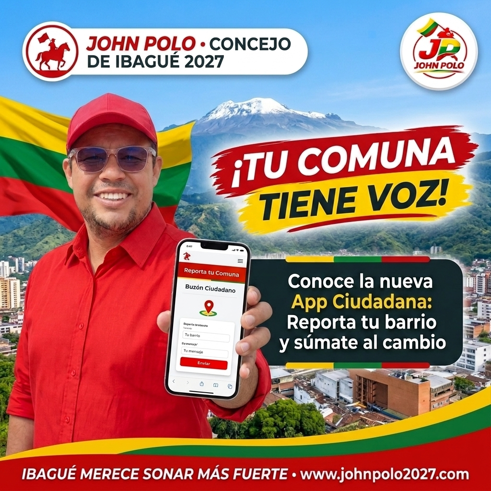
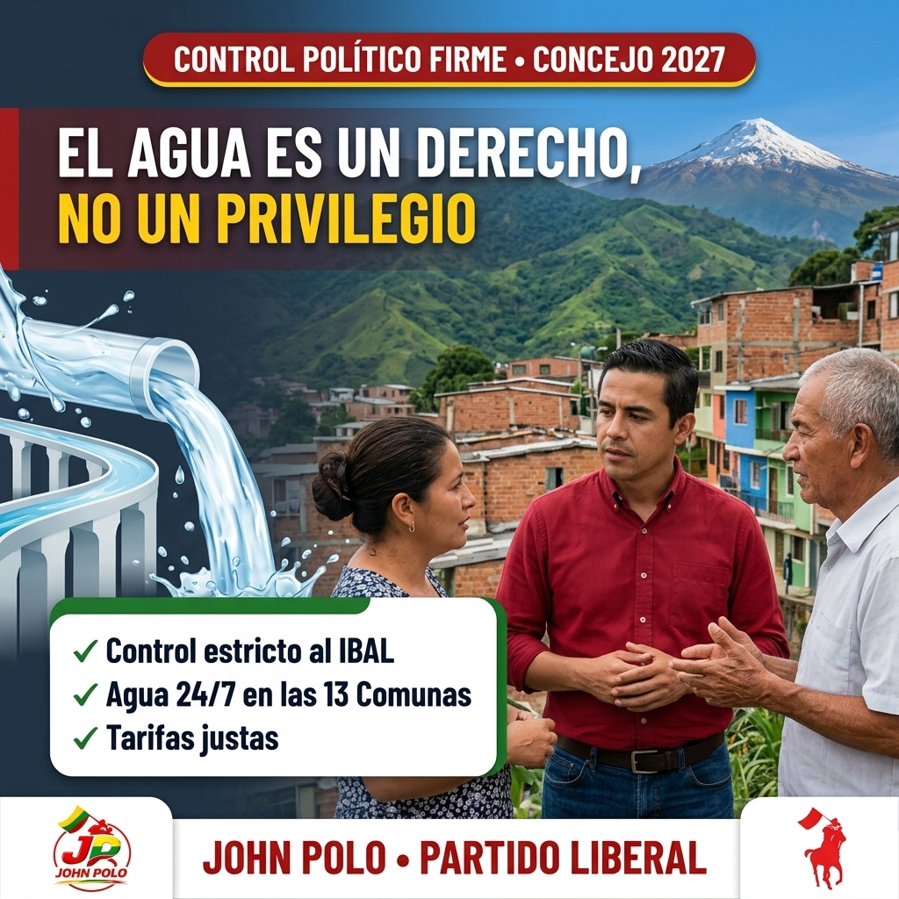
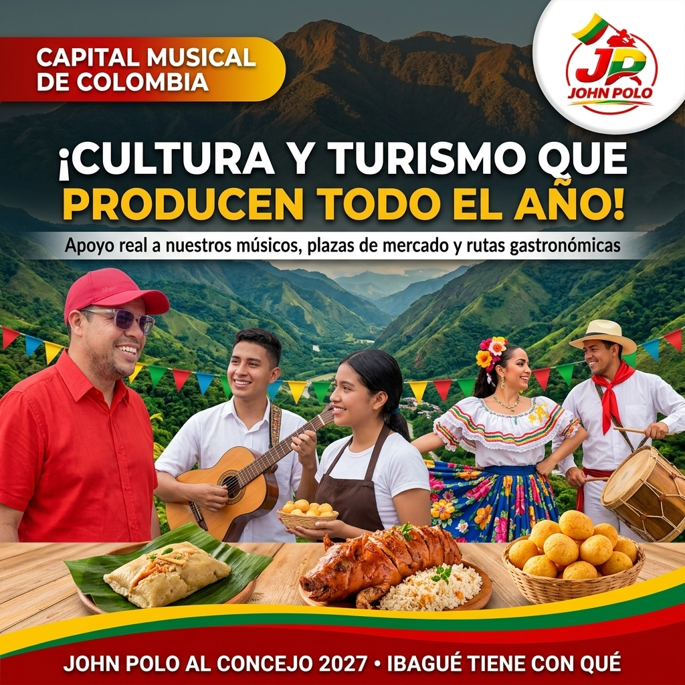
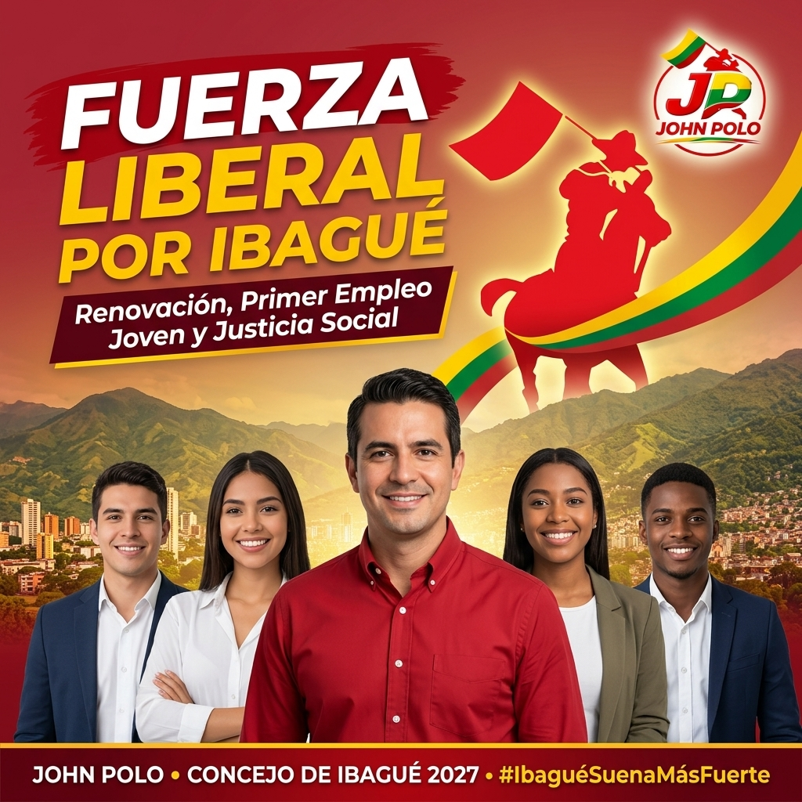
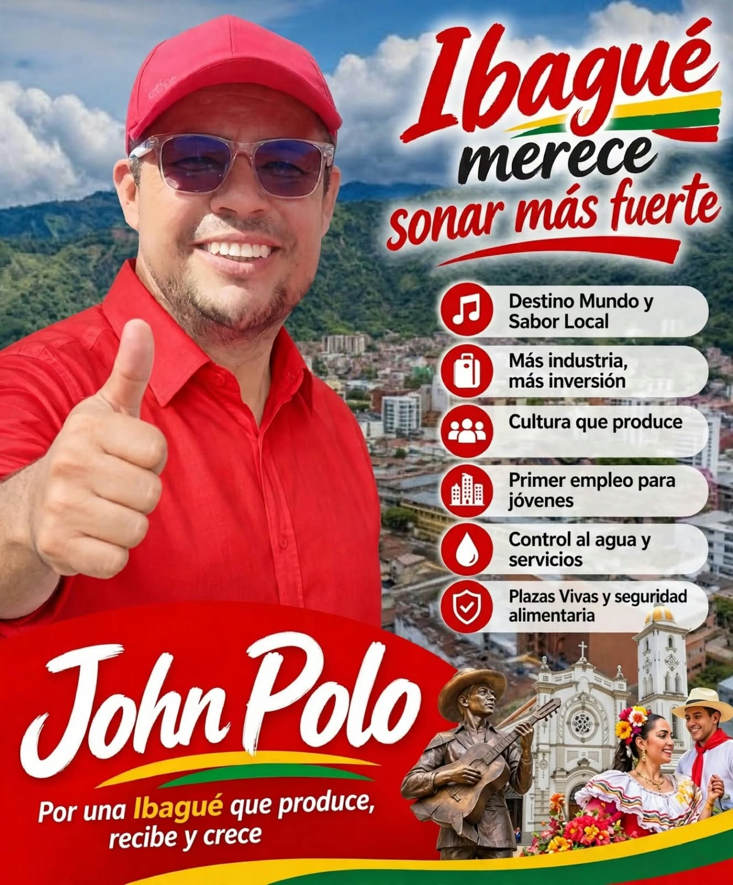

# 📱 Banco de Textos y Publicaciones (Instagram & Facebook)
## Campaña: John Polo al Concejo de Ibagué 2027 - Partido Liberal Colombiano
> **Atribución:** Contenidos redactados con base en los principios del Partido Liberal Colombiano y el programa ciudadano presentado por John Polo.

---

### POST 1: Lanzamiento de la Plataforma Oficial & Buzón Comunal
* **Objetivo:** Tráfico web y participación ciudadana.
* **Redes:** Instagram Feed (1080x1080) y Facebook.
* **Imagen Oficial Generada:** [`imagenes_posts/post_01_lanzamiento_plataforma.jpg`](./imagenes_posts/post_01_lanzamiento_plataforma.jpg)



```text
¡Hoy damos un paso histórico hacia una forma diferente de hacer política en Ibagué! 🏛️🚩

Presentamos oficialmente nuestra plataforma web y aplicación móvil: un espacio diseñado para que ningún barrio se quede sin voz y para que cada ciudadano sea protagonista de las decisiones de nuestra ciudad.

En nuestra plataforma podrás:
📍 Seleccionar tu Comuna (1 a la 13 o corregimiento) y reportar problemas de agua, vías o empleo.
📋 Conocer a fondo nuestras 3 Grandes Apuestas para el Concejo de Ibagué 2027.
🎫 Generar y descargar tu propia Tarjeta Digital de Apoyo para tus estados.
📲 Chatear directamente con nuestro equipo de trabajo por WhatsApp.

Las maquinarias tradicionales tienen el poder del dinero; nosotros tenemos la fuerza de las ideas, la berraquera de los jóvenes y el orgullo por nuestra tierra tolimense.

👉 Ingresa ahora mismo en: https://www.jhonpolo2027.vercel.app/ (enlace directo en la biografía).

#JohnPolo #ConcejoDeIbagué #IbaguéMereceSonarMásFuerte #EsHoraDeCreer #PartidoLiberal #Tolima #Ibagué2027 #ParticipaciónCiudadana
```

---

### POST 2: El Agua es un Derecho, No un Privilegio (Fiscalización IBAL)
* **Objetivo:** Generar debate comunitario y capturar inconformidades en comentarios.
* **Redes:** Facebook (especialmente grupos locales como "Barrios de Ibagué", "Ibagué Se Respeta") e Instagram.
* **Imagen Oficial Generada:** [`imagenes_posts/post_02_control_agua_ibal.jpg`](./imagenes_posts/post_02_control_agua_ibal.jpg)



```text
Es indignante que en la ciudad con una de las mayores cuencas hídricas del país, miles de familias en el Sur, en El Salado y en las comunas populares tengan que vivir pendientes de cuándo les cortan el agua. 💧🚫

Desde el Concejo de Ibagué ejerceremos un control político implacable:
1️⃣ Exigiremos cronogramas públicos y auditados a cada obra de acueducto complementario.
2️⃣ Fiscalizaremos las tarifas para que la ineficiencia del IBAL no la pague el bolsillo de los ibaguereños.
3️⃣ Realizaremos audiencias públicas descentralizadas en cada comuna con presencia obligatoria de los directivos de servicios públicos.

El agua no es un favor que nos hacen; es un derecho constitucional básico.

Déjanos en los comentarios: ¿En qué comuna vives y cuántas veces a la semana se va el agua en tu sector? Los leemos a todos para construir el mapa de denuncias. 👇

#ControlPolítico #AguaParaIbagué #IBAL #ConcejoIbagué #JohnPolo2027 #PartidoLiberal #IbaguéDigna
```

---

### POST 3: Dignidad para Nuestros Músicos y el Festival Folclórico
* **Objetivo:** Conectar con el sector cultural, gestores, bailarines y gremios gastronómicos.
* **Redes:** Instagram Reel / Post carrusel.
* **Imagen Oficial Generada:** [`imagenes_posts/post_03_cultura_festival_folclorico.jpg`](./imagenes_posts/post_03_cultura_festival_folclorico.jpg)



```text
Ibagué es la Capital Musical de Colombia ante el mundo, pero esa música no puede sonar solo una semana en junio. 🎶🇨🇴

Nuestros lutieres, compositores, parejas de baile del bambuco y comparsas merecen vivir con dignidad los doce meses del año. 

Nuestra propuesta es muy clara:
✨ Crear el Fondo Municipal de Circulación Artística, para que colegios, polideportivos y plazas de mercado tengan agenda cultural financiada todo el año con contratos formales y pagos a tiempo para nuestros talentos locales.
✨ Impulsar la ruta gastronómica de la lechona y el tamal como patrimonio turístico generador de empleo formal para madres cabeza de familia y jóvenes.

Cultura que se apoya es economía que produce. 

Por una Ibagué que produce, recibe con calidez y crece. ¡Ibagué merece sonar más fuerte! 🚩

#CapitalMusical #FestivalFolclórico #CulturaIbagué #TamalTolimense #LechonaTolimense #JohnPolo #Tolima
```

---

### POST 4: Respaldo del Partido Liberal: Tradición y Juventud
* **Objetivo:** Posicionar el aval y el símbolo del caballo liberal entre la base del partido y votantes independientes.
* **Redes:** Facebook, Instagram y grupos de líderes.
* **Imagen Oficial Generada:** [`imagenes_posts/post_04_respaldo_partido_liberal.jpg`](./imagenes_posts/post_04_respaldo_partido_liberal.jpg)



```text
Nos identifican los valores que históricamente han transformado a Colombia: la justicia social, la educación pública como motor de igualdad y la defensa férrea de los intereses de la gente de a pie. 🐎🚩

Llegamos con el respaldo del Partido Liberal Colombiano al Concejo de Ibagué 2027, con un compromiso inquebrantable:
✅ Cero complacencia con el malgasto de los recursos públicos.
✅ Prioridad absoluta al empleo digno y formación tecnológica de los jóvenes.
✅ Protección a los microempresarios de barrio y plazas de mercado frente a cobros injustos.

El rojo liberal en Ibagué hoy representa renovación, juventud y ganas de hacer las cosas bien.

Súmate a la fuerza del cambio con John Polo. Escríbenos al WhatsApp oficial (enlace en el perfil) para ser parte de nuestro comité en tu barrio.

#PartidoLiberal #FuerzaLiberal #JohnPoloConcejo #Ibagué2027 #RenovaciónPolítica #IbaguéSuenaMásFuerte
```

---

### POST 5: Mensaje de Fin de Semana (Territorio y Familia)
* **Objetivo:** Humanización de la precampaña y cercanía.
* **Redes:** Instagram Stories, Facebook y Estados de WhatsApp.
* **Imagen Oficial Generada:** [`imagenes_posts/post_05_fin_de_semana_territorio.jpg`](./imagenes_posts/post_05_fin_de_semana_territorio.jpg)



```text
No hay nada más reconfortante que recorrer las calles de Ibagué, sentir el abrazo cálido de nuestra gente y escuchar las ganas que tienen de ver a su ciudad salir adelante. ❤️🏔️

Cada conversación en una tienda de esquina, cada apretón de manos con los vivanderos de la plaza y cada idea compartida con los jóvenes nos confirman que el camino es el correcto: trabajar con la gente y para la gente.

Ibagué tiene con qué. Es hora de creer.

¡Feliz domingo para todas las familias de nuestras 13 comunas y el hermoso sector rural! ☕🫔

#DomingoIbaguereño #GenteBuena #JohnPolo #TolimaDeCorazón #IbaguéMereceSonarMásFuerte
```

